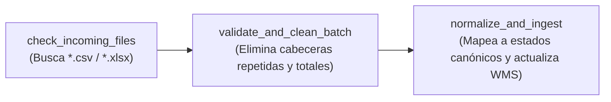

# Guía de Despliegue y Operación de Airflow con CeleryExecutor y RabbitMQ

Este documento detalla la arquitectura, configuración y pasos operativos para el entorno de orquestación distribuida de **CargaExpress (Sprint 3)**, cubriendo:
- **HU-26 (RIWI-131)**: Set up Airflow in Docker
- **HU-29 (RIWI-143)**: Configure CeleryExecutor in Airflow connected to RabbitMQ
- **HU-28 (RIWI-139)**: Type-C file ingestion DAG (procesamiento batch con limpieza y normalización)

---

## 1. Arquitectura de Servicios

El stack está orquestado mediante `docker-compose.airflow.yml` y convive en la red `cargaexpress`:

```
+-----------------------------------------------------------------------------------+
| Red Docker: control_tower_cargaexpress                                            |
|                                                                                   |
|  +--------------------+         AMQP 5672        +-----------------------------+  |
|  |  airflow-scheduler | -----------------------> |    rabbitmq                 |  |
|  +--------------------+                          | (3-management-alpine)       |  |
|            |                                     | Web UI: 15672               |  |
|            | (Task definitions)                  +-----------------------------+  |
|            v                                                    |                 |
|  +--------------------+                                         v (Queue tasks)   |
|  | airflow-webserver  |                          +-----------------------------+  |
|  | Web UI: 8080       |                          |    airflow-worker           |  |
|  +--------------------+                          |   (Celery Worker)           |  |
|            |                                     +-----------------------------+  |
|            |                                                    |                 |
|            +-----------------------+----------------------------+                 |
|                                    |                                              |
|                                    v                                              |
|                      +---------------------------+                                |
|                      |        airflow-db         |                                |
|                      |  (PostgreSQL 16 dedicado) |                                |
|                      |   Puerto local: 5433      |                                |
|                      +---------------------------+                                |
+-----------------------------------------------------------------------------------+
```

### Componentes:
1. **RabbitMQ (`rabbitmq:3-management-alpine`)**: Message Broker para Celery. Expone puerto 5672 para comunicación AMQP y 15672 para la consola web de gestión.
2. **Airflow DB (`airflow-db`)**: Base de datos dedicada de PostgreSQL 16 para el metastore de Airflow, aislada del WMS operacional. Expuesta en host: `5433`.
3. **Airflow Init (`airflow-init`)**: Contenedor transitorio que ejecuta migraciones (`airflow db migrate`) y asegura el usuario administrador inicial.
4. **Airflow Webserver (`airflow-webserver`)**: UI administrativa de Airflow en el puerto `8080`.
5. **Airflow Scheduler (`airflow-scheduler`)**: Planificador y monitor del ciclo de vida de los DAGs con `CeleryExecutor`.
6. **Airflow Worker (`airflow-worker`)**: Proceso Celery Worker que consume tareas concurrentes encoladas en RabbitMQ.
7. **Volúmenes Mapeados**:
   - `./dags`: Directorio de DAGs montado en `/opt/airflow/dags`.
   - `./logs`: Logs de ejecución montados en `/opt/airflow/logs`.
   - `./plugins`: Plugins personalizados montados en `/opt/airflow/plugins`.
   - `./data`: Archivos de entrada/salida montados en `/opt/airflow/data`.

---

## 2. Instrucciones para Levantar el Stack

### Paso 1: Configurar Variables de Entorno (Opcional)
Si deseas ajustar credenciales o puertos, copia `.env.example` a `.env` o define las variables:
```bash
# Variables por defecto incluidas en docker-compose.airflow.yml
AIRFLOW_WEBSERVER_PORT=8080
AIRFLOW_DB_PORT=5433
RABBITMQ_MANAGEMENT_PORT=15672
```

### Paso 2: Inicializar y Levantar Servicios
Ejecuta el siguiente comando en la raíz del repositorio (`C:\Users\J1shu\cargaexpress\control_tower`):

```bash
docker compose -f docker-compose.airflow.yml up -d
```

### Paso 3: Verificar el Estado de los Contenedores
```bash
docker compose -f docker-compose.airflow.yml ps
```
Todos los servicios (`airflow-webserver`, `airflow-scheduler`, `airflow-worker`, `airflow-db`, `rabbitmq`) deben encontrarse en estado `running` o `healthy`.

---

## 3. Accesos y Credenciales

| Servicio | URL / Host | Usuario por Defecto | Contraseña por Defecto |
|---|---|---|---|
| **Airflow UI** | [http://localhost:8080](http://localhost:8080) | `admin` | `admin` |
| **RabbitMQ Management** | [http://localhost:15672](http://localhost:15672) | `guest` | `guest` |
| **Airflow Postgres Metastore** | `localhost:5433` (db: `airflow`) | `airflow` | `airflow` |

---

## 4. Pipeline de Ingesta Tipo C (`dag_type_c_ingestion`) - HU-28

El DAG `dag_type_c_ingestion` procesa archivos por lotes (CSV/XLSX) depositados por transportadoras Tipo C en la carpeta `data/type_C_simulation_data/`.

### Fases de Ejecución:


1. **`check_incoming_files`**:
   - Escanea el directorio `/opt/airflow/data/type_C_simulation_data`.
   - Detecta archivos de transportadoras (`CARRIER_1`, `CARRIER_2`, `CARRIER_3`).
2. **`validate_and_clean_batch`**:
   - Descarta encabezados repetidos intermedios generados por corrupción o corte de páginas.
   - Filtra filas de resumen/pie de página (como `TOTAL REGISTROS: N` o `--- FIN DE LOTE ---`).
   - Remueve registros duplicados y valida columnas mínimas.
3. **`normalize_and_ingest`**:
   - Consulta el catálogo de mapeo de estados (`state_mapping` en PostgreSQL o fallback interno).
   - Traduce `raw_status` al catálogo canónico (`CREATED`, `PICKED_UP`, `IN_TRANSIT`, `OUT_FOR_DELIVERY`, `EXCEPTION`, `DELIVERED`, `RETURNED`, `LOST_OR_DAMAGED`).
   - Actualiza la guía correspondiente en `shipping_labels` si el WMS se encuentra conectado.
   - Archiva los archivos completados en el subdirectorio `processed/`.

---

## 5. Pruebas y Validación

### Validar Sintaxis del Archivo Compose
```bash
docker compose -f docker-compose.airflow.yml config
```

### Validar Sintaxis del DAG en Python
```bash
python -m py_compile dags/dag_type_c_ingestion.py
```

### Probar Ejecución Manual del DAG desde CLI de Airflow
Para disparar y probar el DAG manualmente dentro del contenedor:
```bash
docker compose -f docker-compose.airflow.yml exec airflow-webserver airflow dags trigger dag_type_c_ingestion
```

Para listar las tareas y verificar su ejecución en el worker de Celery:
```bash
docker compose -f docker-compose.airflow.yml exec airflow-webserver airflow tasks list dag_type_c_ingestion
docker compose -f docker-compose.airflow.yml exec airflow-worker celery --app airflow.executors.celery_executor inspect active
```

### Detener el Stack
```bash
docker compose -f docker-compose.airflow.yml down
```
*(Para limpiar también los volúmenes de datos, agrega la bandera `-v`).*
