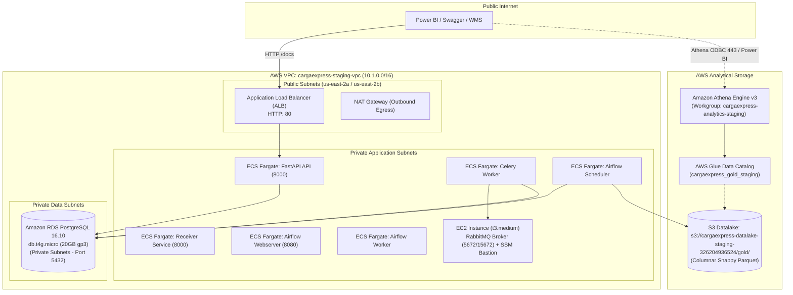

# CargaExpress Control Tower

Production-grade Backend API, Event Processing Engine, and Analytical Control Tower for multi-carrier logistics operations across Colombia, Mexico, and Peru.

[](https://github.com/cargaexpress/cargaexpress_control_tower/actions)
[](LICENSE)
[](https://www.python.org/)
[](https://fastapi.tiangolo.com/)
[](https://aws.amazon.com/)

---

## 1. System Overview

CargaExpress Control Tower centralizes freight lifecycle tracking, SLA compliance monitoring, operational penalty calculations, and carrier reconciliation across three heterogeneous integration tiers:
- **Type A (Direct Webhooks)**: Real-time event ingestion over HMAC-SHA256 authenticated HTTP endpoints.
- **Type B (Polling REST APIs)**: Scheduled extraction orchestrated by Apache Airflow across multi-engine carrier simulators.
- **Type C (Batch SFTP/S3 Files)**: Scheduled CSV/EDI batch processing with checksum deduplication and quarantine validation.

The system features an automated **dual architecture**:
1. **OLTP (Operational Layer)**: 24 tables managing transactional orders, picking, dispatch, tracking events, anomaly detection, and operational ledger entries.
2. **OLAP (Kimball Dimensional Model)**: 10 tables (6 conformed dimensions + 4 fact tables) synchronized between Amazon RDS PostgreSQL and AWS S3 Gold Layer (Parquet format) queried via Amazon Athena and visualized in Power BI Desktop.

---

## 2. Infrastructure & Cloud Architecture (AWS Staging)

The platform is deployed and fully operational in **AWS `us-east-2` (Ohio)** under a strict multi-tier VPC topology managed by Terraform:



### Staging Endpoints & Resources

- **Public Swagger UI**: [http://cargaexpress-staging-alb-353383531.us-east-2.elb.amazonaws.com/docs](http://cargaexpress-staging-alb-353383531.us-east-2.elb.amazonaws.com/docs)
- **Health Check Endpoint**: [http://cargaexpress-staging-alb-353383531.us-east-2.elb.amazonaws.com/api/v1/health](http://cargaexpress-staging-alb-353383531.us-east-2.elb.amazonaws.com/api/v1/health) (Returns `{"status":"ok","database":"up"}`)
- **OpenAPI Schema**: [http://cargaexpress-staging-alb-353383531.us-east-2.elb.amazonaws.com/openapi.json](http://cargaexpress-staging-alb-353383531.us-east-2.elb.amazonaws.com/openapi.json) (43 routes active)
- **Database Endpoint**: `cargaexpress-staging-postgres.cnmosmsqi0oq.us-east-2.rds.amazonaws.com:5432` (Private VPC access only)
- **Bastion / SSM Target**: `i-004830098afc09efb` (Online)

---

## 3. Technology Stack

- **Runtime & Language**: Python 3.12 (bytecode precompiled, multi-stage runtime).
- **Web & Async Framework**: FastAPI, Uvicorn, AsyncPG, Pydantic v2.
- **Data & ORM**: PostgreSQL 16.10, SQLAlchemy 2.0 (Async), Alembic (12 versioned migrations).
- **Message Broker & Queues**: RabbitMQ 3.13 (Erlang 26), Celery 5.4.
- **Orchestration**: Apache Airflow 2.9.3 (CeleryExecutor, dynamic polling DAGs).
- **Analytical Engine & Storage**: Amazon S3, AWS Glue Data Catalog, Amazon Athena Engine v3, Apache Parquet (Snappy), Power BI Desktop.
- **Infrastructure as Code (IaC)**: Terraform >= 1.10, AWS Systems Manager (SSM), AWS Secrets Manager, AWS KMS (CMK).

---

## 4. Local Development Quickstart

### Prerequisites
- Docker Desktop & Docker Compose v2
- AWS CLI v2 (configured with IAM user credentials)
- Python >= 3.12 and `uv`

### 1. Clone the Repository
```bash
git clone https://github.com/cargaexpress/cargaexpress_control_tower.git
cd cargaexpress_control_tower
```

### 2. Configure Local Environment
```powershell
Copy-Item .env.example .env
```

### 3. Run with Docker Compose
```bash
docker compose up --build
```
Access local endpoints:
- API Documentation: http://localhost:8000/docs
- Health Check: http://localhost:8000/api/v1/health

---

## 5. Power BI & Analytical Model Connectivity

Power BI connects to CargaExpress through two authorized channels:

### Option A: Amazon Athena (Direct S3 Gold Layer - Recommended)
Direct querying against Parquet files in S3 without VPNs or tunnels:
- **Connector**: Amazon Athena
- **Server / Region**: `us-east-2`
- **Catalog**: `AwsDataCatalog`
- **Database**: `cargaexpress_gold_staging`
- **Workgroup**: `cargaexpress-analytics-staging`
- **S3 Output Location**: `s3://cargaexpress-athena-results-staging-326204936524/`

### Option B: PostgreSQL Database (via Encrypted AWS SSM Tunnel)
1. Open the secure SSM port-forwarding session in PowerShell:
   ```powershell
   aws ssm start-session `
     --target i-004830098afc09efb `
     --document-name AWS-StartPortForwardingSessionToRemoteHost `
     --parameters portNumber=5432,localPortNumber=5453,host=cargaexpress-staging-postgres.cnmosmsqi0oq.us-east-2.rds.amazonaws.com `
     --region us-east-2
   ```
2. Connect Power BI to:
   - **Server**: `localhost:5453`
   - **Database**: `cargaexpress_staging`
   - **User**: `powerbi_user` (Read-only analytics user)

---

## 6. Repository Structure

```text
cargaexpress_control_tower/
├── backend/                       # FastAPI application & business logic
│   ├── alembic/                   # Alembic database migrations (12 revisions)
│   ├── app/
│   │   ├── api/v1/                # REST API routers (orders, analytics, health)
│   │   ├── core/                  # Security, auth, configuration
│   │   ├── models/                # SQLAlchemy ORM operational models
│   │   └── schemas/               # Pydantic validation schemas
│   └── Dockerfile                 # Hardened multi-stage build (299 MB)
├── infrastructure/terraform/      # Terraform modules & environment definitions
│   ├── bootstrap/                 # S3 state bucket & DynamoDB lock configuration
│   ├── environments/
│   │   ├── staging/               # Staging environment configuration
│   │   └── production/            # Production environment configuration
│   └── modules/                   # Reusable IaC modules (ECS, RDS, S3, Athena, etc.)
├── scripts/                       # Operational automation & auditing scripts
├── docker-compose.yml             # Local multi-container orchestration
└── README.md                      # Project documentation root
```

---

## 7. Security & Compliance Standards

- **Zero Open Database Ingress**: Port 5432 is strictly bound to private subnets; `0.0.0.0/0` is permanently forbidden.
- **Encrypted Secrets Lifecycle**: All passwords and API keys are stored in AWS Secrets Manager and encrypted with KMS CMK `2235219b-e9c1-424d-aac8-bcee68017222`.
- **Role-Based Access Control**:
  - `cargaexpress_admin`: DDL, schema migrations, and admin endpoints.
  - `powerbi_user`: Read-only access restricted to `SELECT` on public tables.
- **Conventional Commits**: All codebase changes follow Conventional Commits 1.0.0 specifications (`feat:`, `fix:`, `refactor:`, `test:`, `docs:`, `chore:`).
